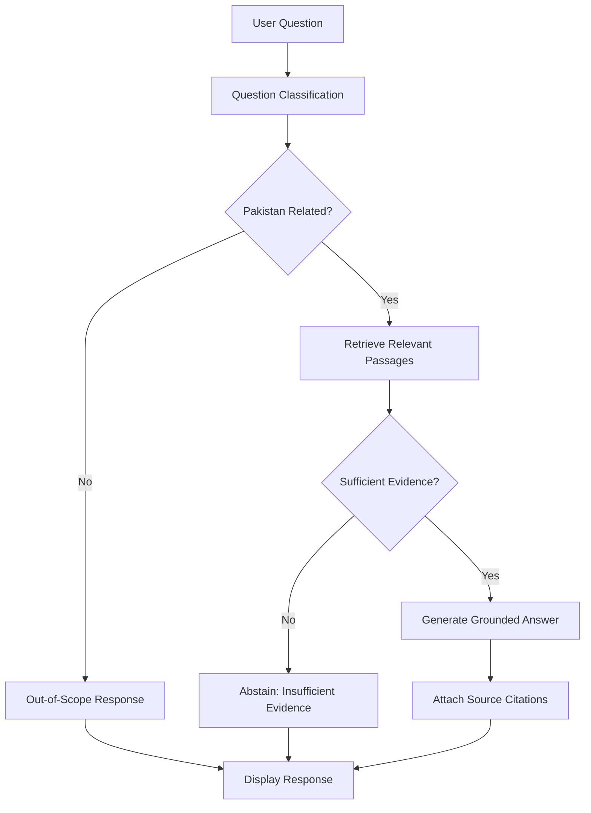

# 🇵🇰 PakKnowledge AI — Your Trusted Guide to Pakistan

**PakKnowledge AI** is a Pakistan-focused Retrieval-Augmented Generation (RAG) chatbot designed to provide evidence-based answers about Pakistan using a collection of indexed documents.

The application retrieves relevant information from a knowledge base, verifies whether the retrieved evidence is sufficient, and generates answers with source citations. It is designed to avoid unsupported answers and politely decline questions outside its Pakistan-focused scope.

## 🚀 Live Demo

PakKnowledge AI is deployed and available online through Streamlit Community Cloud.

**Live Application:** [https://pakknowledge-ai.streamlit.app/](https://pakknowledge-ai.streamlit.app/)

The deployed application uses a pre-indexed ChromaDB knowledge base included in this repository. Users can ask questions using the existing indexed Pakistan-related documents without uploading or indexing documents themselves.

### Deployment Configuration

- **Hosting Platform:** Streamlit Community Cloud
- **Application Framework:** Streamlit
- **LLM Provider:** Groq API
- **LLM Model:** `openai/gpt-oss-20b`
- **Vector Database:** ChromaDB
- **Database Location:** `data/chroma_db/`
- **API Key Management:** Streamlit Cloud Secrets

**Security:** The `GROQ_API_KEY` is configured through Streamlit Cloud Secrets. It is not stored in the public GitHub repository.

## ✨ Features

- **Pakistan-focused knowledge:** Answers questions about Pakistan's history, geography, government and laws, economy, education, culture, tourism, and public services.
- **Document ingestion:** Supports PDF, DOCX, and TXT files.
- **Semantic search:** Uses ChromaDB to retrieve relevant document passages.
- **RAG architecture:** Generates answers using retrieved document evidence rather than relying only on the language model's general knowledge.
- **Evidence verification:** Checks whether retrieved passages sufficiently support an answer.
- **Source citations:** Provides references to supporting documents and available page information.
- **Scope classification:** Identifies and politely declines questions unrelated to Pakistan.
- **Abstention handling:** Avoids generating answers when the available evidence is insufficient.
- **Interactive interface:** Provides a Streamlit-based chatbot interface with theme options and chat functionality.

## Application Preview

### Desktop Interface


### Mobile Interface

<div align="center">
<table>
  <tr>
    <td align="center">
      
      <br />
      <sub><b>Main Screen</b></sub>
    </td>
    <td align="center">
      
      <br />
      <sub><b>Chat View</b></sub>
    </td>
  </tr>
</table>
</div>

## 🛠️ Technologies Used

| Technology | Purpose |
|---|---|
| Python | Core application development |
| Streamlit | Interactive web interface |
| LangGraph | Workflow orchestration |
| ChromaDB | Vector database and document retrieval |
| Groq API | Large language model inference |
| OpenAI Python SDK | API client configured for Groq |
| PyPDF | PDF document processing |
| docx2txt | Word document processing |

## 🏗️ System Architecture

PakKnowledge AI follows a Retrieval-Augmented Generation workflow.



### How It Works

1. The user submits a question through the Streamlit interface.
2. LangGraph coordinates the question-processing workflow.
3. The question is classified to determine whether it relates to Pakistan.
4. Relevant passages are retrieved from the ChromaDB knowledge base.
5. The retrieved evidence is checked for relevance and sufficiency.
6. If sufficient evidence is available, the LLM generates an evidence-based answer with citations.
7. If the evidence is insufficient, the chatbot returns an abstention response instead of guessing.

## 📁 Project Structure

```text
PakKnowledge-AI/
│
├── data/
│   └── chroma_db/
│       └── ... (pre-indexed ChromaDB database)
│
├── images/
│   ├── desktop-preview.png
│   ├── mobile-preview-1.png
│   └── mobile-preview-2.png
│
├── ingestion/
│   ├── __init__.py
│   ├── indexer.py
│   └── load_documents.py
│
├── retrieval/
│   ├── __init__.py
│   └── search.py
│
├── app.py
├── graph.py
├── llm_client.py
├── requirements.txt
├── .env.example
├── .gitignore
└── README.md
```

**Note:** The pre-indexed ChromaDB database is included in the GitHub repository for deployment. Original source documents are stored locally and excluded from the repository.

## ⚙️ Installation and Setup

Follow these steps to run PakKnowledge AI locally.

### 1. Clone the Repository

```bash
git clone https://github.com/Muntazir-43/PakKnowledge-AI.git
```

Navigate into the project directory:

```bash
cd PakKnowledge-AI
```

### 2. Create a Virtual Environment

```bash
python -m venv .venv
```

Activate it on Windows PowerShell:

```powershell
.\.venv\Scripts\Activate.ps1
```

### 3. Install Dependencies

```bash
pip install -r requirements.txt
```

### 4. Configure the Groq API

Create a `.env` file in the project root using `.env.example` as a template.

Add your Groq API key:

```env
GROQ_API_KEY=your_groq_api_key_here
GROQ_MODEL=openai/gpt-oss-20b
```

Replace the placeholder with your own API key.

You can obtain an API key from [Groq Console](https://console.groq.com/).

**Security:** Never upload your `.env` file or expose your API key publicly.

### 5. Run the Application

The repository already contains the pre-indexed ChromaDB database, so you do not need to run document indexing just to start the application.

Run:

```bash
streamlit run app.py
```

Open the application in your browser:

```text
http://localhost:8501
```

You can now ask questions about Pakistan using the chatbot interface.

## 📚 Document Ingestion

PakKnowledge AI currently supports the following document formats:

- PDF
- DOCX
- TXT

Place your documents inside the appropriate category folders under:

```text
data/documents/
```

For example:

```text
data/documents/history/
data/documents/geography/
data/documents/economy/
```

Run the indexing process:

```bash
python -m ingestion.indexer
```

The ingestion pipeline processes supported documents, extracts their text, divides the content into chunks, and stores the indexed information in ChromaDB.

The vector database is persisted locally in:

```text
data/chroma_db/
```

**Important:** If you add or modify documents, rebuild or update the ChromaDB database and commit the updated database files to GitHub if you want those changes to appear in the deployed application.

## 💬 Example Questions

Here are some example questions you can ask:

| Category | Example Question |
|---|---|
| History | What were the major events leading to the creation of Pakistan? |
| Geography | What are the major geographical features of Pakistan? |
| Government & Laws | What does the Constitution of Pakistan say about fundamental rights? |
| Economy | What are the major sectors of Pakistan's economy? |
| Education | What are the main objectives of Pakistan's Federal Education Policy? |
| Culture | What are some important elements of Pakistan's cultural heritage? |
| Tourism | What activities does Pakistan offer for adventure tourism? |
| Public Services | What information do the indexed documents provide about public services in Pakistan? |

The answers depend on the information available in the indexed knowledge base.

## 🔒 Reliability and Limitations

PakKnowledge AI incorporates evidence verification and abstention mechanisms to improve answer reliability.

- Answers are grounded in retrieved indexed documents.
- Source citations are provided for supported answers.
- Questions outside the intended Pakistan-related scope are declined.
- Questions without sufficient supporting evidence receive an abstention response.

### Knowledge Base Dependency and Answer Accuracy

The accuracy, relevance, and completeness of PakKnowledge AI's responses depend significantly on the documents available in its indexed knowledge base.

Several factors influence answer quality:

- **Number of documents:** A larger collection of relevant documents can provide broader topic coverage and more supporting information.
- **Document quality:** Accurate, reliable, and well-structured documents help improve the quality of retrieved evidence.
- **Topic coverage:** Questions about topics that are not sufficiently covered by the indexed documents may receive incomplete answers or an insufficient-evidence response.
- **Information freshness:** Outdated documents may result in outdated information.
- **Retrieval limitations:** Even when relevant information exists in the knowledge base, the retrieval process may not always identify every useful passage.

Adding more documents does not automatically guarantee more accurate answers. The documents should be relevant, trustworthy, sufficiently detailed, and properly indexed.

PakKnowledge AI uses evidence verification and an abstention mechanism to avoid generating answers when the retrieved information does not provide sufficient support.

### Current Limitations

- Only PDF, DOCX, and TXT document ingestion is implemented.
- Website URL ingestion and live web retrieval are not currently supported.
- Answer quality depends on the relevance, coverage, and quality of indexed documents.
- The deployed application uses the pre-indexed database committed to the repository. New documents must be indexed and the updated database deployed to become available online.
- This is an MVP project and has not been designed as a fully production-scale service.

## 🔮 Future Improvements

Potential future enhancements include:

- Website URL ingestion and web-based retrieval.
- Improved document retrieval and ranking.
- Expanded and regularly updated Pakistan-related knowledge sources.
- Additional evaluation datasets and automated testing.
- More scalable database storage and deployment infrastructure.

These are planned improvements, not currently implemented features.

## 👨‍💻 Author

**Muntazir Mehdi**

GitHub: [@Muntazir-43](https://github.com/Muntazir-43)

## 📄 License

A license has not yet been selected for this repository. Please check the repository for licensing information before reusing or distributing the project.